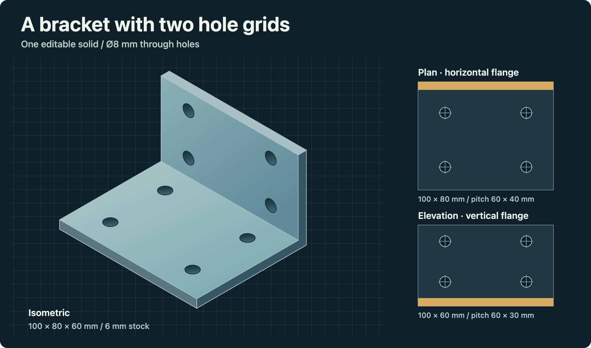
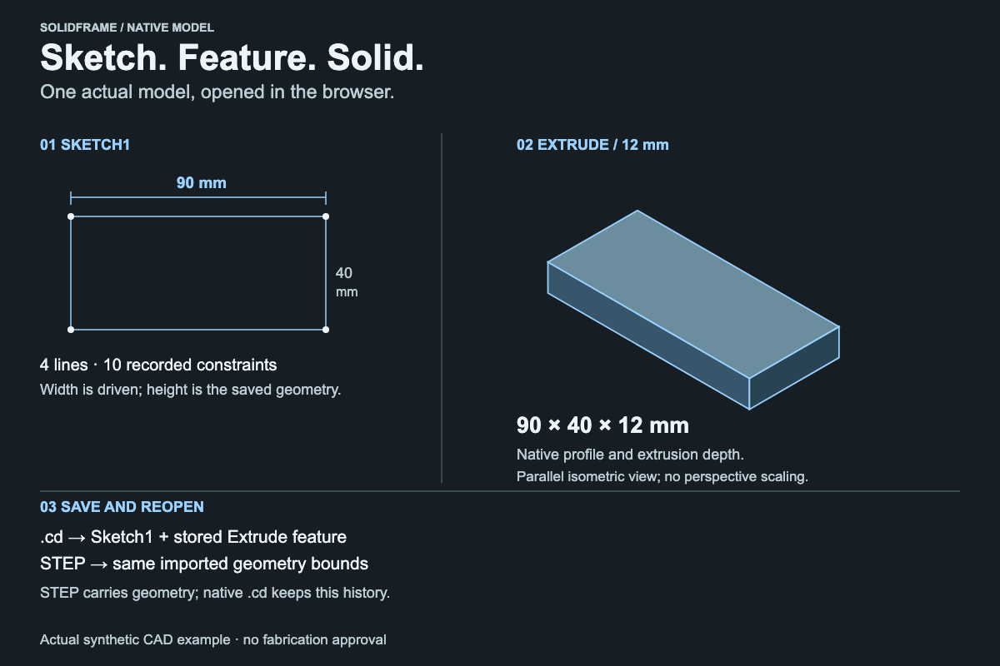
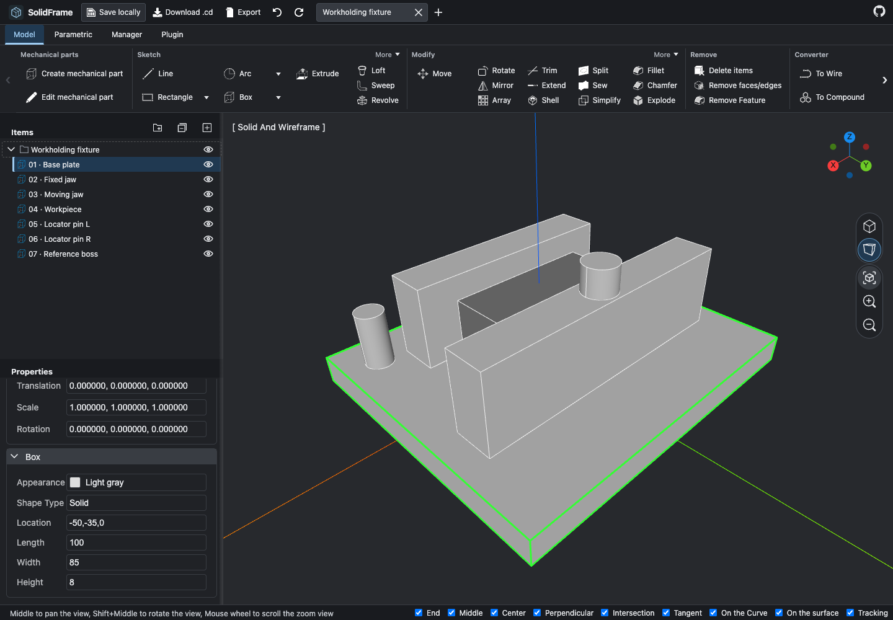

# SolidFrame

**Browser CAD for parts you can revise.**

Draw a constrained sketch, build a solid, and keep its dimensions editable. SolidFrame runs in the browser on [Chili3D](https://github.com/xiangechen/chili3d) and the OpenCascade WebAssembly kernel.

[Open the bracket in SolidFrame](https://nazeeh111.github.io/SolidFrame/?model=https://raw.githubusercontent.com/nazeeh111/SolidFrame/refs/heads/main/docs/presentation/drilled-bracket.cd) · [Try the bracket workflow](docs/mechanical-parts.md#try-the-drilled-bracket) · [Engine reference](UPSTREAM_README.md)

<picture>
  <source media="(max-width: 600px)" srcset="docs/presentation/bracket-mobile.png">
  
</picture>

The bracket stores its stock dimensions and two hole grids in one native part. Edit a grid, check both flanges at the same scale, and apply the new geometry together. [View the editable bracket file](docs/presentation/drilled-bracket.cd). To save it, use **Download raw file** in GitHub’s file toolbar.

## A modeling workspace

[Open SolidFrame’s workspace](https://nazeeh111.github.io/SolidFrame/) to start a new document or open your own file.

- **Sketch and feature modeling:** constrained sketches, extrusion, revolve, fillet, chamfer and feature booleans, with stored feature definitions and replay.
- **Direct solid tools:** primitives, transforms, booleans, measurement and geometry operations in the modeling ribbon.
- **Mechanical parts:** dimensioned plates and right-angle brackets, coupled hole-layout validation, atomic edits and native-document persistence.
- **Local projects:** undo/redo, browser snapshots, portable native documents and geometry exchange. No account or cloud service is required for normal CAD work.

The underlying CAD engine and its existing tools come from Chili3D. SolidFrame's specific additions are described under [Project development](#project-development); they do not imply independent authorship of the kernel, sketch solver or inherited modeling tools.

## Sketch to solid

<picture>
  <source media="(max-width: 600px)" srcset="docs/presentation/feature-chain-mobile.png">
  
</picture>

**The sketch and its feature remain editable.** This completed example drives a rectangle's width to **90 mm**, extrudes it **12 mm**, then reopens both the native model and its STEP export. The current height is **40 mm**. The diagram comes from the actual saved profile and feature; it is separate from the [live application's reopened model capture](docs/presentation/native-reopened.png).

[View the native .cd model](docs/presentation/rectangle-extrusion.cd) · [View the STEP geometry](docs/presentation/rectangle-extrusion.step) · [Inspect the actual workflow and limits](docs/presentation/README.md)

To save either file, use **Download raw file** in GitHub's file toolbar.

The [worked native document](docs/presentation/README.md) contains `Sketch1` and `Parametric Body1`. Its stored extrusion refers to the sketch and its four profile edges. In the completed run, undo removed the new body, redo restored it, and downloading/reopening `.cd` retained the sketch and feature. The live application then imported the saved STEP into a separate new document with matching bounds.

Use **Open document** on the home screen for the native `.cd`. For STEP, create a new document and use **Model → Import**. Use **Fit Content** to frame either model. Native `.cd` keeps this editable history; STEP carries exchange geometry. Matching bounds do not establish every topology, model, format or downstream manufacturing workflow.

## Design a drilled part

The mechanical part builder creates a rectangular mounting plate or a sharp right-angle bracket from dimensions in millimetres. Set the stock dimensions and centered round through-hole grids; brackets have separate horizontal and vertical flange layouts. The editor checks the complete configuration before rebuilding the native solid, including hole spacing, edge clearance and the inside corner of a bracket.

Edit the saved part through the dedicated part editor. Apply commits the configuration together, and undo/redo restores parameter changes. Invalid or cancelled edits keep the previous valid part. Native `.cd` documents retain the dimensions and hole layouts; STEP and STL exports contain geometry rather than the editable builder settings.

This workflow models ideal geometry. It does not calculate sheet-metal bend allowance, thread or fastener standards, structural strength, or fabrication approval. See [mechanical parts](docs/mechanical-parts.md) for the controls, supported ranges and verification.

## Start with real geometry



The completed live sample has **Width 85 mm** after editing 70→85 mm, undoing to 70 mm and redoing to 85 mm. Appearance controls display color and texture.


Choose **Open editable sample** on the home screen. The workholding fixture contains seven native, editable solids: a base plate, two jaws, a workpiece, two locator pins, and a reference boss. It is an illustrative CAD exercise, not a fabrication-approved fixture.

1. The sample opens with **01 · Base plate** selected. Select another part in the model tree to edit it.
2. Change its width, depth, or height in Properties. The geometry is rebuilt by OpenCascade, not approximated by a display mesh.
3. Use the modeling ribbon to add a primitive, boolean operation, fillet, transform, or measurement. The Parametric tab provides constrained sketches and feature operations.
4. Use **Save locally** to store a snapshot in this browser. Use **Download .cd** to download a portable, editable project file.
5. Select the objects to export, choose **Export**, select a format and confirm. STEP, IGES, BREP, STL, OBJ and PLY are supported. Import STEP, IGES, BREP or STL through the file controls. Exchange files contain geometry and may discard the editable structure preserved by `.cd`.

The fixture's parts have independent dimensions; changing one part does not automatically constrain the others. The full sketch-constraint system remains available for your own parametric models.

When closing the last view of a document, choose **Save and close**, **Close without saving**, or **Cancel**. A failed save leaves the document open. Already-started saves finish before the document closes.

In the model tree, Up/Down moves keyboard focus without changing selection; Enter or Space selects, Left/Right collapses or opens groups. Ctrl/Command with Enter or Space retains the existing multi-selection behavior.

On narrow screens, **Items / Properties** opens the model tree and editable dimensions. Camera, zoom and snap controls remain available; **Fit Content** frames the model after rotating or resizing the view. On larger screens the panels remain beside the workspace. Camera and zoom controls and command confirmation buttons can be reached by keyboard and activated with Enter or Space.

## Run locally

Requires Node.js 22 or later and npm. The included WebAssembly binaries mean a C++ toolchain is not needed for the standard app build.

```sh
npm ci
npm run dev
```

Open the address printed by Rspack, normally `http://localhost:8080`.

```sh
npm run build
npm run preview
```

The production site is in `dist/`. Serve it through HTTP, rather than opening its HTML with `file://`. Asset URLs work at the origin root or a trailing-slash subpath such as `/SolidFrame/`. The compiled geometry binary is approximately **9.99 MiB**, plus a **571 KiB** sketch solver before HTTP compression and caching. JavaScript and bundled plugin assets add to the first-load size. The distribution also includes a CJK font asset of about 9.33 MiB; its presence in the bundle is not a measurement of a particular browser session’s network transfer. First startup may be slower on a mobile device or slow connection. A browser with WebAssembly and WebGL support is required.

## Local storage and privacy

- CAD calculations run in your browser. No cloud account is required.
- **Save locally** uses the `solidframe-db` browser database; preferences use `solidframe-config`. These are separate from upstream data on the same origin. Existing upstream data is not deleted or migrated; open a downloaded `.cd` file to transfer a project.
- Browser storage is not a backup. Clearing site data or using private browsing may remove saved projects; another device/browser/origin does not share them. Keep downloaded native documents for durable backups.
- Upstream Microsoft Clarity tracking and promotional media feeds have been removed from the active interface.
- Startup `?plugin=` links are ignored. `?url=` and `?model=` accept supported model/document files over HTTP(S); they cannot load executable `.chiliplugin` files. Intentional plugin imports remain available, and imported plugin code must be trusted.
- The optional AI panel starts closed. Opening it explicitly presents a generic Completions API configuration with no endpoint, model, or key filled in. An explicit HTTP(S) endpoint, model, and session key are required before sending; provider-specific presets remain available by choice. These tools are not required or configured for the normal CAD workflow. No billed API is used by the sample, build, or verification workflow.

## Project development

- Original drilled-plate and right-angle-bracket builder with coupled hole-layout validation, atomic parameter editing and native-document persistence.
- SolidFrame project hub, matching light/dark workspace palettes, original mark and fixture illustration, branded loading and recoverable startup errors.
- A compact modeling ribbon with distinct command/menu targets, a separate removal group, visible keyboard focus, and direct access to local save, native-file download and geometry export.
- Selected sample geometry with editable properties, labeled property inputs and keyboard-accessible camera and command controls.
- One-click native fixture with editable Box/Cylinder nodes, serialization support, and one undoable creation transaction.
- No URL-authorized plugin execution, including the model-file alias path; signed model URLs now retain a correct filename.
- Query/fragment-safe bundled plugin paths and subpath-compatible production assets.
- Separate local storage and preference namespaces; readable new-document names.
- Compatible dependency updates resolving the seven advisories reported by the initial npm audit.

## Verification

```sh
npm test
npm run build
npm run check
```

`npm run check` is the upstream Biome command and **writes formatting fixes**. The test suite uses Rstest and Happy-DOM; geometry integration tests load the real local OpenCascade WASM. Added regressions exercise the editable sample's solid geometry, serialization and parameter updates, startup plugin restrictions, and deployment paths. Passing tests are bounded evidence, not a guarantee for every model, browser, or exchange file. See [verification](docs/solidframe-verification.md) for the exact observed checks and limits.

## License

Application code is licensed under [AGPL-3.0](LICENSE); the C++/WASM component carries [its existing LGPL notice](cpp/LICENSE-chili-wasm.txt). Third-party dependencies retain their own licenses. The running app links to corresponding source and license notices from **About & licenses**. See the [technical reference](UPSTREAM_README.md) for architecture and C++ development details.
